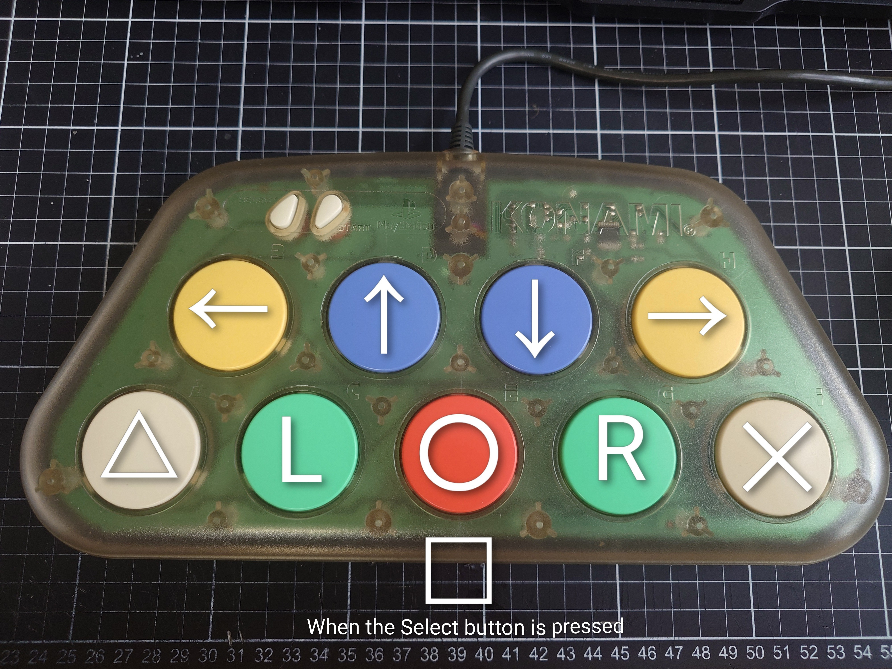
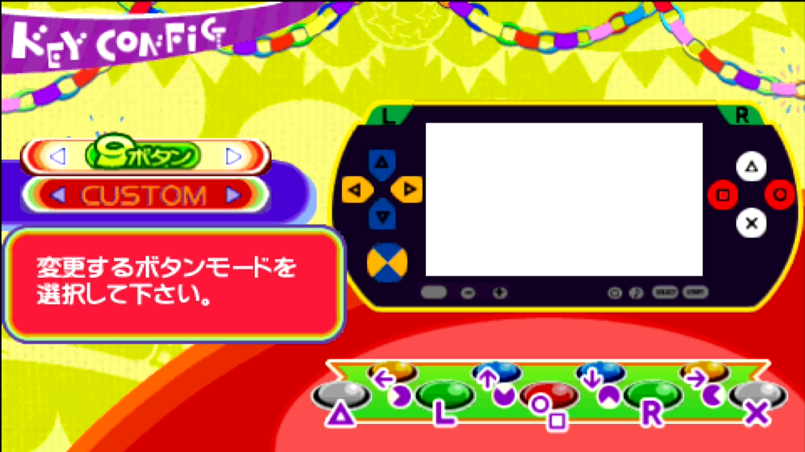
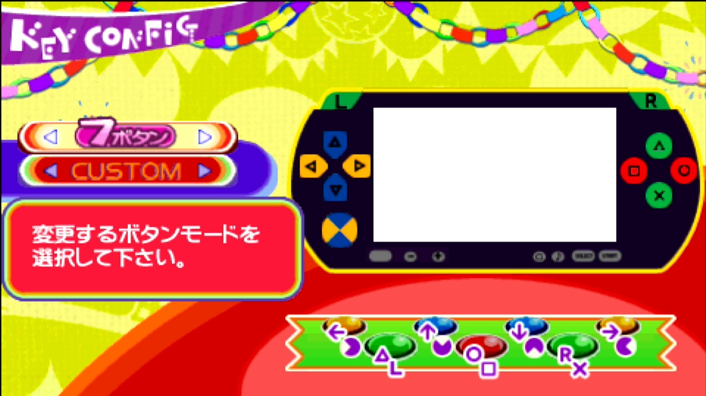
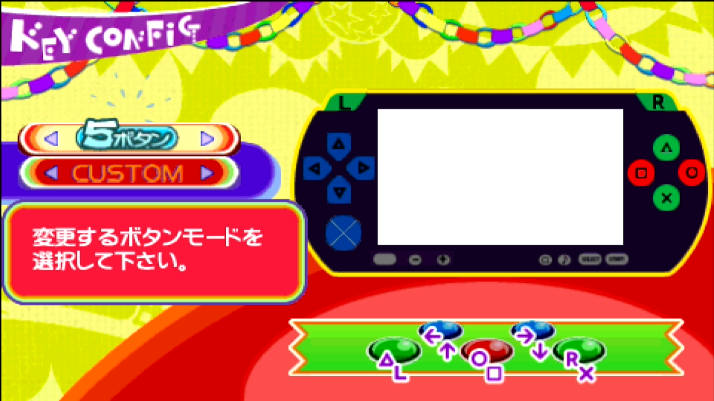
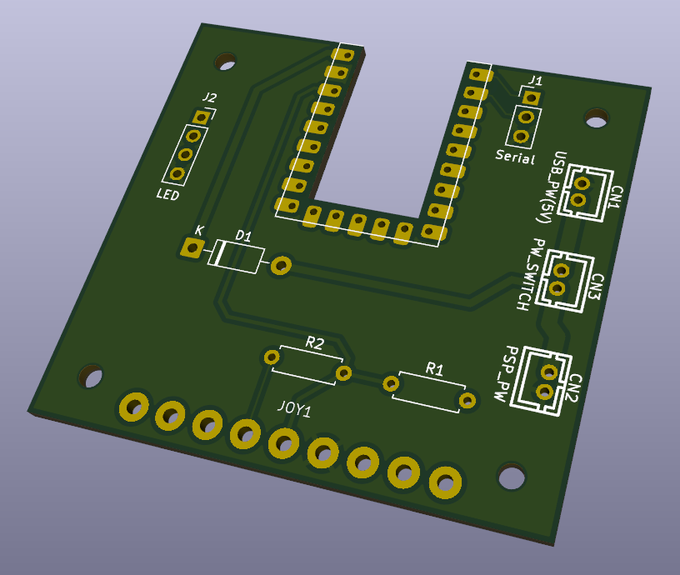

remotejoy-minus Standalone USB Host
==================================

This standalone USB host build enumerates the PSP running remotejoy-minus.prx,
opens the remotejoy-minus bulk endpoints, runs the HostFS-compatible hello
handshake, and sends remotejoy-minus JoyEvent packets from RP2040 input.

Build
-----

Use Pico SDK:

	mkdir -p build
	cd build
	cmake .. -DPICO_SDK_PATH=/path/to/pico-sdk
	make

Flash remotejoy_minus_rp2040.uf2 to the RP2040-zero.

Wiring and Logs
---------------

The RP2040-zero USB port is used as USB host (or as a USB network device in the
Web configuration mode), so USB serial logging is disabled.
Logs go to UART stdio. On the default Pico SDK settings this is UART0:

	GPIO0  UART TX
	GPIO1  UART RX
	GND    common ground

Connect a USB-UART adapter to read logs. Also supply 5V VBUS to the PSP USB
connector. Do not connect the PSP to another USB host at the same time.

Expected Result
---------------

When remotejoy-minus.prx is active on the PSP, the firmware should find:

	interface class/subclass/protocol: ff/01/ff
	bulk IN  endpoint:  0x81
	bulk OUT endpoint:  0x02
	bulk OUT endpoint:  0x03

Then it should print:

	Sending HOSTFS magic to endpoint 0x02
	HOSTFS magic sent
	HostFS hello command: magic 0x782F0812 command 0x8FFC0000 extralen 0
	Sending HostFS hello response to endpoint 0x02
	HostFS hello handshake complete
	Starting RP2040 input scanner

If remotejoy-minus.prx is loaded on the PSP, pressing buttons on the selected
input source should control the PSP after the hello handshake.

Input Source
------------

The default build uses a minimal PS2 controller bitbang reader:

	#define INPUT_SOURCE INPUT_SOURCE_PS2

To return to the previous GPIO/ADC test wiring, change that line in
standalone_usbhost.c to:

	#define INPUT_SOURCE INPUT_SOURCE_GPIO

PS2 Controller Wiring
---------------------

The PS2 controller lines use 3.3V GPIO logic. Do not feed 5V logic into RP2040
GPIO pins. Many PS2 controllers work from 3.3V VCC for logic-only use; if you
power the controller from 5V, use level shifting on DAT/ACK before the RP2040.
Motor power is not used.

Default PS2 bitbang pins:

	GPIO05  ATT / SEL / CS
	GPIO06  CMD
	GPIO07  DAT
	GPIO08  CLK
	GPIO26  ACK(optional)
	GND     common ground
	3V3     controller VCC for logic-only testing

Status RGB LED:

	GPIO27  Red
	GPIO28  Green
	GPIO29  Blue

The default firmware assumes an active-high/common-cathode RGB LED. For a
common-anode LED, set `STATUS_LED_ACTIVE_LOW` to `1` in `standalone_usbhost.c`.

The LED is driven by PWM, so any RGB color can be shown.

LED colors:

	Red             PSP connection waiting / not connected
	Profile color   PSP connected; color of the active mapping profile
	                (set in the Web configuration; black turns it off)
	White           PSP connected, Pop'n Music Controller Mode
	Red breathing   Web configuration mode

With the default profiles the colors are the same as the former right stick
modes: blue (Default), green (Right stick D-pad), magenta (Face swap) and cyan
(Star Soldier).

GPIO27 is also used by the optional GPIO/ADC test wiring as ADC1. If you use
`INPUT_SOURCE_GPIO`, move either the status LED pin or the analog Y pin.

The firmware sends the standard poll command and tries to place the controller
in analog mode at boot. If a controller stays in digital mode, buttons still
work but analog stick reports stay centered.

PS2 Multitap
------------

PS1 multitap support is enabled for the first two controller slots. This is
intended for SCPH-1070-style PS1 multitaps.

Slot 1 is used as the normal remotejoy-minus input source. Slot 2 is sent as a
separate POPS player-2 event stream:

	PS2 multitap slot 2 connected, mode 0x73
	PS2 multitap slot 2 state: raw 0x0000 psp 0x000000 lx 128 ly 128

When Slot 2 is connected, the firmware also sends a player-2 status event so
the PSP plugin can enable POPS 2P support. When Slot 2 is disconnected, the
plugin returns to normal POPS behavior.

The PS2 multitap SCPH-10090 did not respond to this controller-port-only
bitbang wiring. Use a PS1 multitap such as SCPH-1070 for POPS 2P support.

Default PS2 to PSP mapping (profile "Default"):

	PS2 cross     	PSP cross
	PS2 circle    	PSP circle
	PS2 square    	PSP square
	PS2 triangle  	PSP triangle
	PS2 d-pad     	PSP d-pad
	PS2 start     	PSP start
	PS2 select    	PSP select
	PS2 L1        	PSP L trigger
	PS2 R1        	PSP R trigger
	PS2 L2        	VOL- (PSP analog left for PS Archives)
	PS2 R2        	VOL+ (PSP analog right for PS Archives)
	PS2 L2 + R2   	PSP analog up (for PS Archives)
	PS2 L3        	NOTE (PSP sound)
	PS2 R3        	PSP home
	PS2 start+L2  	PSP volume down
	PS2 start+R2  	PSP volume up

Everything above can be changed in the Web configuration. VOL-/VOL+ are
handled by the PSP plugin as the virtual L2/R2 (PS Archives analog
left/right, and volume with START), and NOTE as the PSP sound button, so
those behaviors follow whichever PS2 button they are assigned to.

Fixed combinations, independent of the profile:

	PS2 start+left 	PSP display(Brightness only)
	PS2 start+right PSP home
	PS2 start+R3  	next mapping profile

Default Mapping Profiles
------------------------

START+R3 switches to the next profile. START plus a button mapped to COMBO
does the same. START is not sent to the PSP while the chord is held. The selected profile is saved and restored at the next power-on.

The default profiles reproduce the former START+R3 right stick modes:

	Default            standard mapping above (blue)
	Right stick D-pad  right stick PSP d-pad (green)
	Face swap          right stick PSP face buttons,
	                   PS2 face buttons PSP d-pad (magenta)
	Star Soldier       D-pad rotated for PSP Star Soldier's vertical play
	                   style (cyan)

Star Soldier profile D-pad rotation:

	PS2 up   	PSP right
	PS2 down 	PSP left
	PS2 left 	PSP up
	PS2 right	PSP down

The former Star Soldier mode also rotated the left analog stick; the profile
only rotates the D-pad.

Web Configuration
-----------------

Mapping profiles can be edited from a browser. Hold PS2 controller (player 1)
L1 + L2 + D-pad Down while powering on the RP2040-zero to start the Web
configuration mode, then:

1. Connect the RP2040-zero USB port to a PC instead of the PSP. The PS2
   controller stays connected and is powered from the PC.
2. The RP2040-zero appears as a USB network adapter (CDC-NCM; Windows 11,
   macOS and Linux include a driver) and assigns the PC an address by DHCP.
3. Open `http://192.168.7.1/`.
4. Edit the profiles and press **Save settings**, or **Finish setup** to save
   and reboot into normal mode.
5. Disconnect the USB cable from the PC and connect it to the PSP.

The LED breathes red while the configuration mode is active.

The page provides:

- Mapping profile add, delete, select, and save (up to eight profiles).
- PSP-button assignment for PS2 buttons and right-stick directions,
  including HOME, VOL+, VOL-, NOTE and COMBO. VOL-/VOL+ change the volume
  when pressed together with START, as noted on the page.
- Left/right stick dead-zone sliders. A left dead zone of 0% passes the left
  stick through unchanged.
- Eight RGB presets plus custom R/G/B sliders for the profile LED color.
- Mapping JSON export/import. The format is the same as the Pico 2 W build,
  so files can be exchanged between them (Pico 2 W only settings such as
  GunCon gyro mode are ignored).
- Eight UI languages, as on the Pico 2 W.

Mappings are shared by player 1 and player 2 (multitap). Pop'n Music
Controller Mode and the GunCon keep their own fixed mappings.

Pop'n Music Controller Mode
---------------------------

When the dedicated Pop'n Music controller (RU014) is connected, it automatically switches to Pop'n Music controller mode, and the LED lights up white.  
In this mode, the buttons are internally remapped as shown in the image below to control the PSP.  
While the Select button is held down, the Circle button switches to the Square button.  
This is primarily used during gameplay in "Party Mode".   

The detection keys themselves, PS2 left/right/down, are not passed through in
this mode. The mapping profile, START+RIGHT HOME, START+R3 / START+COMBO
profile switching and volume combos are disabled while Pop'n Music Controller Mode is
active.  

To align with the remapping, we recommend configuring the key settings for *PSP Pop'n Music* as shown in the image below.  

Namco GunCon
------------

A Namco GunCon (NPC-103) connected to the player 1 PS2 controller connector is
detected by its controller ID (0x63). Its X/Y coordinates are forwarded
unchanged to the PSP, and remotejoy-minus.prx built with RJM_ENABLE_POPS_AIM=1
presents POPS controller port 1 to the PS1 game as a GunCon. When the gun is
removed, port 1 returns to the normal digital pad.

- The gun's buttons are sent as normal input: the trigger is Circle, A is
  START, and B is Cross. This mapping is fixed and does not follow the mapping
  profile.
- The GunCon measures its position from a CRT's scanning beam. It needs a CRT
  and the gun's video connection; on an LCD it only reports "off screen"
  (X=01h, Y=0Ah).
- The PSP plugin draws a crosshair at the reported position, using typical
  GunCon edge values to place it on screen. Hold A + B for two seconds to show
  or hide it.
- POPS shows the PS1 picture in only part of the display, depending on its
  HOME-menu screen size: on the PSP LCD 320x240 (Original), 360x270
  (Normal), 480x360 cropped (Zoom) or 480x272 (Full); on TV out 640x480 of
  672x480. A gun that reports its position across the whole screen, such as
  a GunCon 3 adapter, is corrected by the PSP plugin so that the edges of the
  PS1 picture map to the GunCon edges: each axis is stretched about the
  centre of the GunCon range (X 269, Y 136) by the picture's share of the
  display (compressed for Zoom, where the picture overflows the screen). On
  the LCD the plugin reads the selected screen size. On TV out the picture
  fills the height, so only X can change: with the TV screen size set to 4:3
  the picture spans the whole width and nothing is corrected, with 16:9 X is
  corrected for the pillarbox. "Off screen" is passed through unchanged.
- Over dark parts of the picture the gun sees no light. A shot there makes
  the PSP plugin flash the screen until the gun reports a position, and only
  then passes the trigger to the game (see "POPS GunCon emulation" in the
  [main README](../README.md)). The crosshair cannot follow over dark parts.
- Only player 1 is supported. A GunCon behind a multitap is not forwarded.

GPIO/ADC Test Wiring
--------------------

All buttons are active-low and use RP2040 internal pull-ups.

	GPIO2   cross
	GPIO3   circle
	GPIO4   square
	GPIO5   triangle
	GPIO6   up
	GPIO7   down
	GPIO8   left
	GPIO9   right
	GPIO10  start
	GPIO11  select
	GPIO12  ltrig
	GPIO13  rtrig

Analog stick:

	GPIO26 / ADC0  X axis
	GPIO27 / ADC1  Y axis

The firmware polls every 10 ms, diffs the current state against the previous
state, and sends only the required remotejoy-minus button/analog events.

PCB
---

It is possible to create circuit boards using services such as JLCPCB and PCBWAY by utilizing the data in the [./pcb](./pcb) folder.

### BOM
| **Reference** | **Part** | **Link** |
|---------|------|------|
|U1 | RP2040-zero (Not welding) | - |
|JOY1 | PS2 Controller Connector (90 degrees Female) | [aliexpress](https://aliexpress.com/item/1005006039721141.html) |
|D1 | SCHOTTKY DIODE 1N5819 (TH) | - |
|R1, R2 | 1k Ohm resistor (TH) | - |

Case
----

You can download the STL file from the link below and create a dock case for your PCB using a 3D printer.  
If you don't have a 3D printer, you can also commission JLC3DP or PCBWAY to make one for you.  
https://www.printables.com/model/1718482-remotojoy-minus-dock  
